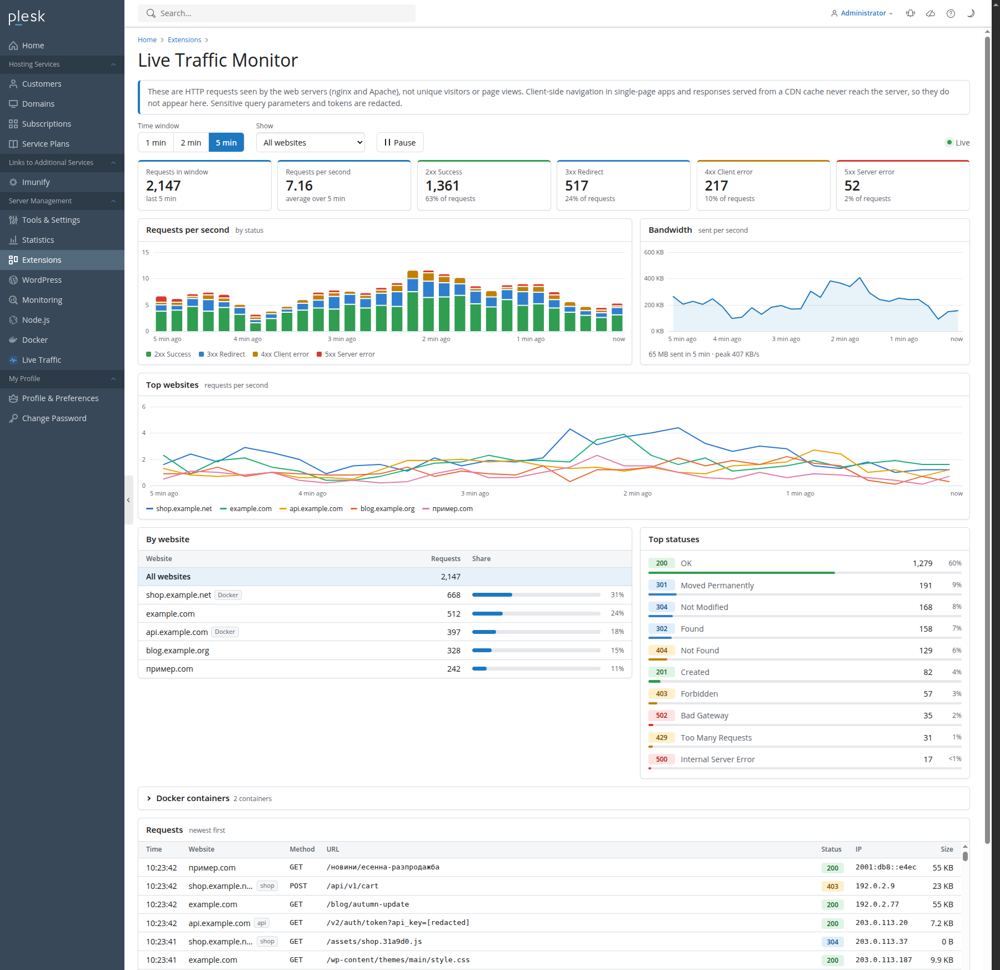

# Live Traffic Monitor for Plesk

**Version 1.2.1** · Plesk Obsidian 18.0.50+ on Linux · [Changelog](CHANGELOG.md)

A Plesk Obsidian extension that adds a **Live Traffic** page for server administrators. The page
shows the HTTP requests reaching every website on the server, nearly in real time.



<sub>The screenshot shows dummy websites and IP addresses from the documentation ranges.</sub>

- **Time windows:** the last 1, 2 or 5 minutes, refreshed every 3 seconds without reloading the page.
- **Summary:** requests per second, plus a breakdown by website and by status. Click a website to
  filter by it.
- **Charts** across the time window: requests per second by status, bandwidth and the busiest
  websites. Hover a chart, or focus it and use the arrow keys, to read the values. Click a website in
  the chart's legend to filter by it.
- **Request list:** the newest requests first, with time, website, method, URL, status, IP address,
  response size and, when the log format records it, the time taken.
- **Docker containers:** requests to websites behind a Docker proxy rule show the container that
  answered them. A collapsible panel lists each container with its state, health, requests and 5xx
  errors; while it is closed, its header still says when a container is stopped or unhealthy.
  Click a container to filter by it.
- **Secrets hidden:** tokens, passwords, e-mail addresses and other secrets in URLs are replaced
  with `[redacted]`.

The counts are **HTTP requests**, not unique visitors or page views. Client-side navigation in
single-page apps and responses served from a CDN cache never reach the server, so they don't appear.

## How it works

The extension reads the access logs Plesk already writes for each website with hosting, including
subdomains, in `/var/www/vhosts/system/<domain>/logs/`:

| File | Written by |
|---|---|
| `proxy_access_ssl_log`, `proxy_access_log` | nginx (HTTPS, HTTP) |
| `access_ssl_log`, `access_log` | Apache (HTTPS, HTTP) |

**One request is counted once, however a website is served.**
- In Plesk's nginx configuration, logging is turned off for the locations nginx proxies to Apache.
  So a request appears in the log of the server that answered it.
- Static files are the one exception. In proxy mode, Apache finds the file and hands it back to nginx
  (X-Accel-Redirect), so both servers log the request.
- In that case the Apache line is dropped and the nginx line is kept. The nginx line has the status
  the client actually received, for example 304 where Apache logged 200.
- The two lines are matched on website, scheme, client IP, method and URL, with nginx's line logged
  up to 60 seconds after Apache's.
- So the counts are right for nginx-only sites, nginx + Apache sites, Docker proxy sites and
  Apache-only servers alike.

**Docker containers.**
- A website with a Docker proxy rule (Websites & Domains → Docker Proxy Rules) is served by Plesk's
  nginx, which passes the requests to a port that a container publishes on the host. nginx logs
  these requests in the website's own log, so they are counted like any other. Container logs are
  never read.
- To name the container, the extension reads the rules (website, URL path, host port) from the
  Docker extension's database, `/usr/local/psa/var/modules/docker/db.sqlite3`, opened read-only. It
  then asks Docker which container publishes that port. A stopped container lists no ports, so its
  configuration is checked instead.
- A request is credited to the rule with the longest matching URL path. Requests nginx answers
  itself are not: plain-HTTP requests to a website that redirects to HTTPS, certificate
  validation (`/.well-known/acme-challenge/`, `/.well-known/pki-validation/`) and invalid requests.
- The state and health come from Docker each time the page refreshes. A container that has stopped
  shows as "Exited", and nginx's 502 answers for it count as its 5xx errors.

**Logs are read incrementally.**
- Each poll reads only the bytes added since the previous one and keeps the parsed requests for 10
  minutes in a small SQLite database (`/usr/local/psa/var/modules/live-traffic-monitor/state/`).
- To start somewhere new, it binary-searches the log by timestamp, so a large log is never scanned
  from the beginning.
- One poll reads at most 4 MB per log and 16 MB in total, for at most about 1 second. Under very
  heavy traffic the page shows that it is catching up instead of blocking the panel.
- Only one poll at a time reads the logs. Others answer from the database.

**Log rotation** is detected from the inode, the file size and the first bytes of each file.
Plesk's daily statistics run truncates the logs in place, and logrotate replaces them; either way
the extension starts over at the right point in time.

**Security**
- Only Plesk administrators can open the page and its data endpoint. Resellers, customers and
  administrators logged in as a customer get "Permission denied".
- The extension runs as Plesk's panel user `psaadm`, which can already read the logs. It changes no
  permissions and runs nothing as root.
- `psaadm` is in the `docker` group, which Plesk's Docker extension relies on, so the extension can
  ask Docker directly over `/var/run/docker.sock`. It only sends `GET` requests for the list of
  containers and the configuration of stopped ones. From the Docker extension's database it reads
  the proxy rules and the socket setting, never the stored TLS keys.
- URLs are redacted before they are stored:
  - query parameters whose names suggest credentials or personal data (`token`, `key`, `password`,
    `session`, `code`, `state`, `email`, `_wpnonce`, `X-Amz-Signature`, …);
  - values that look like JWTs, e-mail addresses, long hex strings or random tokens;
  - token-like path segments.
- Referers and user agents are not stored.
- The page builds everything as text (`textContent`), never as HTML.

## Installation

You need root access to the server:

```sh
curl -fsSLo /tmp/live-traffic-monitor.zip \
  https://github.com/katsar0v/plesk-statistics/releases/download/v1.2.1/live-traffic-monitor-1.2.1-1.zip
plesk bin extension --install /tmp/live-traffic-monitor.zip     # use --upgrade for a newer version
rm /tmp/live-traffic-monitor.zip
```

The extension then appears as **Live Traffic** under Server Management in the navigation and in
Tools & Settings. To remove it: `plesk bin extension --uninstall live-traffic-monitor`.

## Limitations

- Requests for the server's own hostname, the default virtual host, webmail and the Plesk panel
  aren't included, only websites with hosting.
- **Response time** needs a log format that ends with it in seconds, like nginx's `$request_time`.
  Plesk's default format doesn't record it, so the "Time taken" column is hidden.
- **Duplicate detection** relies on Apache logging the real client IP. Plesk does this by default
  with `mod_remoteip`.
- **Docker rules on a remote Docker host** are shown by their target address, with the state
  "Unknown". Only the local Docker is asked.
- **Overlapping Docker rules** of one website are matched by the longest URL path. nginx's own
  order of regular-expression locations is not reproduced.

## Development

Requires PHP 8.1+ with `pdo_sqlite`, Composer and `zip`.

```sh
composer install
make check      # php -l, PHPStan against the Plesk API stubs, PHPUnit
make package    # dist/live-traffic-monitor-<version>-<release>.zip
make dev        # local preview at http://127.0.0.1:8099/ with generated traffic, see dev/README.md
```

- `src/` is the extension package: `meta.xml`, `htdocs/`, `plib/` and `_meta/`.
- The log reading lives in `src/plib/library/`. It is plain PHP without Plesk dependencies, so the
  tests run without a Plesk server.
- The JSON exchanged between the page and the server is described in
  [docs/data-contract.md](docs/data-contract.md).

## License

GPL-3.0-or-later. See [LICENSE](LICENSE).
